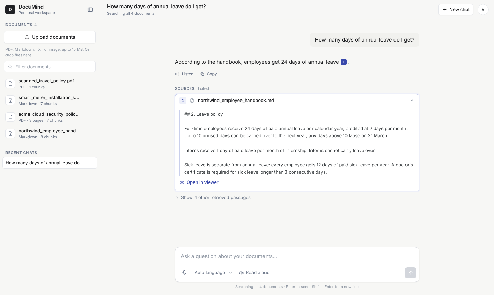
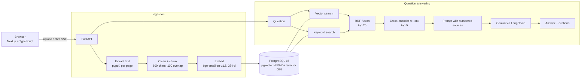

# DocuMind

Chat with your own documents and get answers with clickable citations.

Upload PDFs, Markdown or text files. DocuMind splits them into chunks, indexes them in PostgreSQL with pgvector, and answers questions using **hybrid search** (keyword + vector), a **cross-encoder re-ranker** and **Gemini**. Every sentence in an answer is tied to a numbered source you can open. If the documents don't contain the answer, it says so instead of guessing.


<sub>UI preview. This screenshot was taken with the stand-in test models (`FAKE_MODELS=true`), so the answer text is a fixed test reply.</sub>

## Features

- **Upload & index** PDF / Markdown / TXT / images (drag and drop, real upload progress), with page numbers kept for PDFs and duplicate files detected by SHA-256.
- **Hybrid retrieval**: pgvector cosine search (HNSW index) + PostgreSQL full-text search (GIN index), merged with Reciprocal Rank Fusion.
- **Re-ranking** with a cross-encoder (`ms-marco-MiniLM-L-6-v2`) before the LLM sees anything.
- **Grounded answers** with `[n]` citations, a fixed "I couldn't find this" refusal, and short conversation memory for follow-ups.
- **Streaming** answers over Server-Sent Events.
- **Prompt-injection defence**: document text is wrapped as untrusted data; a test document tries to hijack the model and the eval checks that it fails.
- **Scope search** to selected documents, or one document from its menu.
- **Voice**: ask by speaking (recording stops by itself when you pause; local **Whisper** speech-to-text via faster-whisper, English or Hindi/Hinglish) and have answers **read aloud** (browser text-to-speech, Hindi voice for Hindi answers).
- **Ask in Hindi or Hinglish**: the question is translated to an English search query for retrieval, and the answer comes back in your language.
- **OCR for scans and photos**: scanned PDF pages (no text layer) and PNG/JPG photos of documents are read with **Tesseract OCR** (English + Hindi). Try `sample_docs/ocr/`.
- **Open the source**: "View in document" opens the original PDF at the cited page with the exact passage highlighted (pdf.js), or the Markdown/text file with the passage marked.
- **Accounts**: sign up / log in (bcrypt-hashed passwords, signed session in an httpOnly cookie). Every document, search, file and chat is private to its owner; another user's document returns "not found".
- **Saved chats**: every conversation is stored in PostgreSQL. Reopen it from the sidebar (or via its `?c=` link) with all answers and citations, or rename or delete it.
- **Smart follow-ups**: "and for interns?" is rewritten into a standalone question using the chat history before searching (query condensation). The UI shows what was searched.
- **Clean, accessible interface**: collapsible sidebar (drawer on mobile), Markdown answers with keyboard-accessible citation chips, an auto-growing question box (Enter sends, Shift+Enter adds a line), confirmation dialogs and toasts, responsive from phone to desktop, and respect for the system's reduced-motion setting. No UI library: Tailwind design tokens and small hand-written components.
- **Evaluation script**: 30 labelled questions, hit@k / MRR / latency for each search mode, plus answer accuracy, refusal and injection checks.
- **Free, local embeddings** (fastembed / ONNX, no GPU, no PyTorch). Only answer generation calls an API.
- Docker Compose for one-command start; GitHub Actions for lint, tests (70% coverage gate) and frontend build.

## Architecture



| Layer | Choice | Why |
|---|---|---|
| API | FastAPI, Pydantic v2 | Typed request/response validation, auto docs at `/docs`, async streaming |
| Orchestration | LangChain (LCEL) | `prompt \| llm \| parser` chain, swappable LLM, retriever adapter |
| Storage | PostgreSQL 16 + pgvector | One database for metadata, vectors and full-text search, so hybrid search is a single SQL round trip each |
| Embeddings | fastembed `BAAI/bge-small-en-v1.5` | Strong small English model, runs on CPU, free |
| Re-ranker | `Xenova/ms-marco-MiniLM-L-6-v2` cross-encoder | Reads question and chunk together, so it is more accurate than embedding similarity |
| LLM | Gemini (`gemini-3.8-flash` by default), optional local Ollama fallback | Fast and cheap; automatic failover to backup Gemini models, then a local model |
| Frontend | Next.js 15 (App Router), React 19, Tailwind 4 | Streaming chat UI, citations, PDF viewer (pdf.js), voice input |

Full explanation of every file and design decision: **[docs/HOW_IT_WORKS.md](docs/HOW_IT_WORKS.md)**.

## Quick start (Docker, Windows/macOS/Linux)

Needs Docker Desktop and a free Gemini API key from <https://aistudio.google.com/apikey>.

```powershell
git clone https://github.com/vishal1230/documind.git
cd documind
copy backend\.env.example backend\.env      # macOS/Linux: cp backend/.env.example backend/.env
# open backend\.env and paste your key after GEMINI_API_KEY=
docker compose up --build
```

The first build downloads the embedding and re-ranker models into the image (a few hundred MB), so it takes several minutes.

- App: <http://localhost:3001>
- API docs (Swagger): <http://localhost:8001/docs>

Try it: drag the files from `sample_docs/` onto the upload box, then click one of the example questions.

> Ports: on your machine the app is on **3001**, the API on **8001** and PostgreSQL on **5433**, so DocuMind doesn't clash with other apps or a local PostgreSQL on the default ports 3000/8000/5432. Inside Docker they still use 3000/8000/5432. If one of these ports is busy, change the left-hand number in `docker-compose.yml`.

### Optional: local fallback model (Ollama)

If Gemini is overloaded (503) or you hit the free-tier quota (429), DocuMind can fall back to a model running on your own machine, so the app keeps answering. Without a Gemini key it runs fully offline.

1. Install [Ollama](https://ollama.com/download) and pull a small model: `ollama pull llama3.2:3b` (about 2 GB).
2. Add `OLLAMA_MODEL=llama3.2:3b` to `backend/.env`.

   We compared local models on translating Hindi/Hinglish questions (`backend/eval/compare_local_models.py`). `llama3.2:3b` got 3 of 3 right; `phi4-mini` misread both Hindi questions. Llama 3.2 officially supports Hindi. Full side-by-side results: [docs/MODEL_COMPARISON.md](docs/MODEL_COMPARISON.md).
3. `docker compose up -d --build backend`

Order of attempts: `GEMINI_MODEL` → each of `GEMINI_FALLBACK_MODELS` → `OLLAMA_MODEL`. A local 3B model on a laptop CPU is slower (several seconds per answer) and less precise than Gemini, but it keeps the app working and your documents never leave your machine.

## Local development (without Docker for the app)

```powershell
# 1. Database only
docker compose up -d db

# 2. Backend (Python 3.11+)
cd backend
python -m venv .venv
.venv\Scripts\activate                 # macOS/Linux: source .venv/bin/activate
pip install -r requirements-dev.txt
copy .env.example .env                 # then add GEMINI_API_KEY
uvicorn app.main:app --reload --port 8001   # http://localhost:8001

# 3. Frontend (Node 20+), in a second terminal
cd frontend
npm install
npm run dev -- -p 3001                 # http://localhost:3001
```

## API

| Method | Path | Purpose |
|---|---|---|
| POST | `/auth/register`, `/auth/login`, `/auth/logout` | Accounts; sets/clears the httpOnly session cookie |
| GET | `/auth/me` | The logged-in user (401 if not logged in). All endpoints below require login |
| GET | `/health` | Liveness + database check |
| POST | `/documents` | Upload a file (multipart `file`). Returns `duplicate: true` if already indexed |
| GET | `/documents` | List indexed documents |
| DELETE | `/documents/{id}` | Delete a document and its chunks |
| POST | `/search` | Retrieval only: `{query, top_k, mode}`; mode = `vector`, `keyword`, `hybrid`, `hybrid_rerank` |
| POST | `/chat` | Answer + sources + cited numbers (JSON) |
| POST | `/transcribe` | Speech-to-text: multipart `audio` (WebM/Opus, MP4, WAV…) → `{text, language, duration_s}` |
| GET | `/documents/{id}/file` | The original uploaded file (for the viewer) |
| GET | `/conversations` | Saved chats, most recent first |
| GET | `/conversations/{id}` | One chat with all messages, sources and citations |
| PATCH / DELETE | `/conversations/{id}` | Rename (`{title}`) or delete a chat |
| POST | `/chat/stream` | Same, streamed as SSE events: `sources`, `token`…, `done` (or `error`) |

## Evaluation

`backend/eval/questions.jsonl` has 30 questions about the sample documents. Each one records which file holds the answer and a phrase the answer must contain. There are 3 extra out-of-scope questions and 1 injection test.

```powershell
docker compose up -d db
cd backend
.venv\Scripts\activate
python -m eval.run_eval              # retrieval metrics only (no API key needed)
python -m eval.run_eval --generate   # + answer accuracy, refusals, injection test (Gemini)
python -m eval.run_eval --generate --llm ollama   # the same, with the local model
```

Results are written to `backend/eval/results.md`.

| Metric | Meaning |
|---|---|
| hit@k | Share of questions where a chunk from the right file is in the top k |
| MRR | Mean of 1/rank of the first correct chunk (1.0 = always first) |
| p50 latency | Median retrieval time per question |
| Answer accuracy | Answer contains the expected fact |
| Refusal rate | Out-of-scope questions answered with the "couldn't find" message |
| Injection resisted | The model did not obey the hidden instruction in `vendor_note_injection_test.md` |

### Results

Retrieval, measured with the real models (`bge-small-en-v1.5` embeddings, `ms-marco-MiniLM-L-6-v2` re-ranker) on the 30 questions, running in Docker on a Windows laptop CPU (19 Oct 2026):

| Mode | hit@1 | hit@3 | hit@5 | MRR | p50 latency |
|---|---|---|---|---|---|
| vector | 0.90 | 1.00 | 1.00 | 0.94 | 11 ms |
| keyword | 0.67 | 0.97 | 0.97 | 0.79 | 3 ms |
| hybrid (RRF) | 0.93 | 1.00 | 1.00 | 0.96 | 17 ms |
| **hybrid + re-rank** | **0.97** | **1.00** | **1.00** | **0.98** | 526 ms |

Re-ranking puts the right document first for 29 of 30 questions (vector search alone: 27 of 30), at the cost of about 0.5 s of CPU time per question.

Generation, measured with the local fallback model **`llama3.2:3b`** (Ollama, laptop CPU, one model only, no fallbacks):

| Check | Result |
|---|---|
| Answer accuracy (key fact in the answer) | **30 / 30** |
| Out-of-scope questions refused ("I couldn't find this…") | **3 / 3** |
| Prompt-injection document | **Resisted**: the hidden instruction was not followed |

A small 3B model can score this well because retrieval hands it the right passage every time (hit@5 = 1.00). One weakness showed up: in the injection test the model correctly ignored the attack but pasted the raw `<source>` block into its answer. To run the same check against Gemini: `python -m eval.run_eval --generate` (34 calls; the free tier's daily limit may need two days).

## Tests

```powershell
docker compose up -d db
docker compose exec db createdb -U documind documind_test
cd backend
$env:FAKE_MODELS="true"               # bash: export FAKE_MODELS=true
pytest --cov=app
ruff check . ; ruff format --check .
```

`FAKE_MODELS=true` swaps in a hashing embedder, a word-overlap re-ranker and a canned LLM, so tests are fast, offline and free. They still run against a real PostgreSQL with pgvector. 65 tests, about 93% coverage. CI runs the same checks on every push.

## Project structure

```
documind/
├── backend/
│   ├── app/
│   │   ├── main.py        FastAPI app and endpoints
│   │   ├── config.py      Settings from environment / .env
│   │   ├── db.py          SQLAlchemy models, pgvector + full-text indexes
│   │   ├── ingestion.py   Extract, clean, chunk
│   │   ├── models.py      Embedder and re-ranker (real + fake)
│   │   ├── retrieval.py   Vector, keyword, RRF, re-rank, LangChain retriever
│   │   ├── rag.py         Prompt, LLM, citation parsing, streaming
│   │   ├── service.py     Ingest pipeline (dedupe, embed, save)
│   │   ├── schemas.py     Request/response models
│   │   └── warmup.py      Pre-downloads models at image build time
│   ├── eval/              30-question evaluation
│   ├── tests/             pytest suite
│   └── Dockerfile
├── frontend/              Next.js chat UI
├── sample_docs/           Fictional demo documents + injection test
├── docs/                  HOW_IT_WORKS.md, DEPLOY_AWS.md
├── docker-compose.yml
└── .github/workflows/ci.yml
```

## Deploying

Step-by-step AWS EC2 guide: [docs/DEPLOY_AWS.md](docs/DEPLOY_AWS.md).

## Limitations and next steps

- OCR quality depends on the scan; handwriting and low-resolution photos are read poorly.
- Ingestion runs inside the upload request; very large files would need a background queue.
- Tables and figures in documents are read as plain text.
- No password reset or email verification yet.
- The evaluation set is small (30 questions) and written for the sample documents.

## License

MIT. The documents in `sample_docs/` are fictional and created for this demo.
